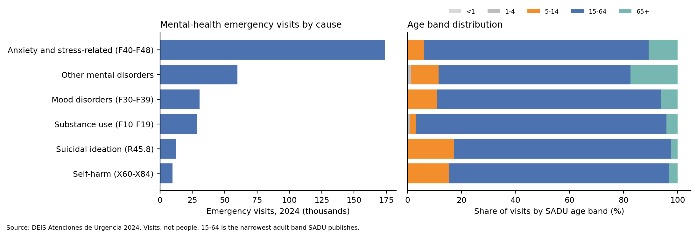
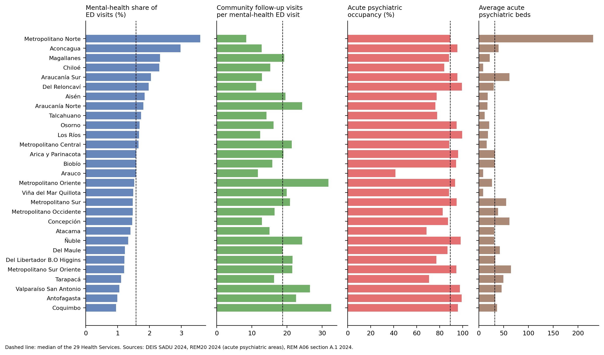
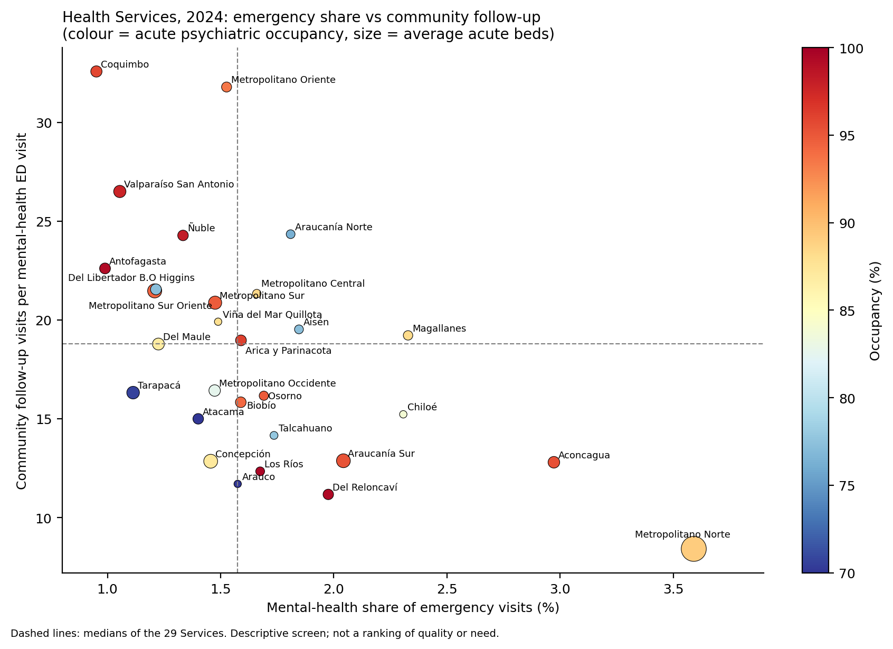
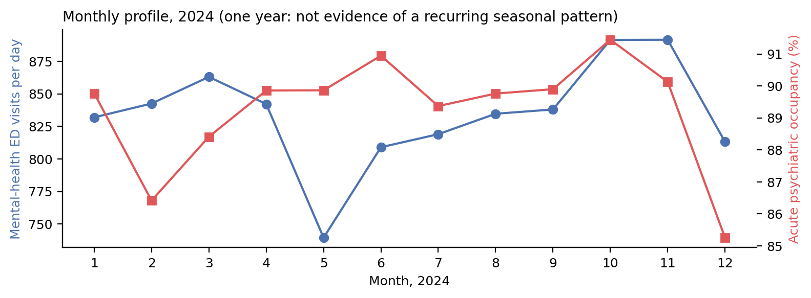

## 1. Summary

In 2024 Chile's public emergency network recorded 305,431 mental-health
visits (1.57% of 19.4 million emergency visits) and 9,753 self-harm visits.
The same year, 1,130 acute psychiatric beds were available on average in
public hospitals, at 89.3% occupancy, and primary and specialty teams
recorded 5.3 million mental-health follow-up visits.

This report compares the 29 Health Services on these three parts of the
pathway: emergency visits, community follow-up and acute psychiatric beds.
The purpose is to help a Health Service decide which part to review first.
The comparison is descriptive and uses one year.

Main findings:

- The two highest mental-health shares of emergency visits (Metropolitano
  Norte 3.6%, Aconcagua 3.0%) come from specialised psychiatric emergency
  departments that receive referrals. Without them both Services are in
  the typical range (1.7% and 1.2%).
- Community follow-up per mental-health emergency visit ranges from 8.4 to
  32.6 (median 18.8). Acute occupancy ranges from 41.5% to 99.6%.
- Five Services are above the median on emergency share, below it on
  community follow-up and at or above 90% occupancy: Biobío, Araucanía Sur,
  Los Ríos, Osorno and Del Reloncaví. Three Services have none of the three
  flags.
- Waiting for a bed cannot be measured: the SADU waiting fields are
  recorded as zero for every facility-day in 2024.

The W1 "stress ratio" is kept only to reconcile W1 figures; it divides visits
by bed-days and cannot show a shortage.

## 2. Problem, foundation and evolution from W1

### 2.1 Problem and scope

| Element | Definition in C1 |
|---|---|
| Problem | Mental-health crises reach emergency departments; whether a Service should first review community follow-up, acute bed capacity or how emergency and hospital care are organised is not visible from any single source |
| Population | Emergency visits with SADU mental-health causes (F00–F99 and R45.8, cause 36) and self-harm (X60–X84, cause 35); all age bands, reported with SADU labels |
| Place | 29 public Health Services (*Servicios de Salud*); public network only |
| Period | Calendar year 2024 (closed year) |
| Units | Visits, hospitalisations, bed-days and follow-up visits; **not people** |
| Proposed use | A descriptive profile and screen that tells a Health Service which area to review first; not a performance ranking |

### 2.2 Documentary support

Each source is used for the claim it supports. Policy documents give
context; they are not used as evidence that a Service fails a legal duty.

- **Policy objective.** The National Health Strategy toward 2030 (MINSAL,
  2022 edition) sets the impact objective "Mejorar la salud mental de la
  población en Chile con enfoque en lo promocional y preventivo" (p. 35).
  Its mental-health section states expected results (e.g. more coverage of
  promotion and prevention actions with an equity focus) but **no numeric
  target**. The W1 report stated a "15% reduction in youth suicide" target;
  it is not in the document and has been removed.
- **Legal context.** Law 21.331 (Diario Oficial, 11 May 2021) defines
  psychiatric hospitalisation as an exceptional and transitory resource,
  used when outpatient treatment is not possible, and prohibits new
  asylum-type psychiatric institutions. It motivates looking at community
  follow-up next to beds. It is not used here to judge compliance.
- **Financing context.** The University of Chile School of Public Health
  report for MINSAL (2024) estimates mental-health spending at 4.89% of total
  health spending in 2022, excluding sick-leave subsidies. The W1 figure of
  "about 2.4% of the budget" had no source and has been removed.
- **Emergency-to-hospital pathway.** González Valderrama et al. (2023)
  studied 90,464 psychiatric emergency visits at Instituto Psiquiátrico
  Dr. José Horwitz Barak (2017–2020): 12.5% led to an indication for
  hospitalisation, and 35.9% of those indications could not be carried out
  for lack of beds. The study separates visits, decisions to hospitalise and
  admissions; C1 follows the same separation with public data.

| Level | Example | Used in C1 as |
|---|---|---|
| Policy objective | ENS 2030 mental-health objective | Context for the decision |
| Numerical target | None in the ENS mental-health section | Not applicable |
| Indicator our data measure | Mental-health share of emergency visits, follow-up visits per emergency visit, acute occupancy | Descriptive comparison between Services |

### 2.3 Alternatives in W1 and why this line was kept

W1 compared two lines: (1) seasonal respiratory visits and critical-care bed
occupancy, and (2) mental-health emergency visits and psychiatric beds.
Line 2 was preferred because it links a documented pathway problem
(emergency visits that need a psychiatric bed, per the Horwitz study) with
three public sources that share a territorial code. Line 1 remains
feasible, but most of its value depends on comparable years to study
seasonality, and it was already a common topic in the course.

The instructor's feedback gave line 2 a clearer purpose: compare community
care, emergency visits and hospital use to show which part of a network
deserves closer attention. C1 adopts that purpose. Section 8.2 records each
piece of advice and the response.

## 3. Seven-step map

| Step | C1 content | Where |
|---|---|---|
| 1. Decision | **Proposed user:** the mental-health unit of a Health Service, or the MINSAL network division that compares Services. **Decision:** which area to review first. **Alternatives:** (a) community follow-up capacity, (b) acute psychiatric bed capacity and management, (c) the organisation of emergency and referral care, (d) no action | §2.1 |
| 2. Success criteria | **Desired outcome:** crises treated in time and at the right level, admissions without long waits. **Measurable now:** each Service's position against the other 28 on five indicators. **Not measurable now:** waiting time, clinical outcomes, number of people | §3, §6 |
| 3. Business questions | **Main:** in 2024, how did the 29 Services differ in mental-health emergency visits, community follow-up and acute psychiatric bed use, and which area deserves a closer look in each? **Supporting:** Q1 composition by cause and age; Q2 concentration in specialised EDs; Q3 variation in follow-up and bed use; Q4 which Services combine flags; Q5 how sensitive the result is to definitions | §5 |
| 4. Business process | Crisis → primary care or COSAM → emergency visit (SAPU, SAR, SUR or hospital ED) → decision to hospitalise → wait for a bed → admission to an acute psychiatric area → discharge → community follow-up. Observed: visits, ED hospitalisations, bed-days, discharges, follow-up visits. **Not observed:** waiting (recorded as zero), transfers between Services, the private sector, patients' residence, outcomes | Fig. A |
| 5. Entities, events, states | Entities: facility, Health Service. Events (aggregated counts): emergency visit, ED hospitalisation, discharge, follow-up visit. State: bed-day available or occupied. No person identifier in any source | §4.1 |
| 6. Data representation | See §4.1: one row per facility-day-cause (SADU), hospital-area-month (REM20) and facility-month-activity (REM A06). Joins: SADU facility code → registry (N:1); all three sources → Health Service code (aggregation, not row joins) | §4.3 |
| 7. Measurement | Indicator definitions with numerator, denominator and unit in §4.5 | §4.5 |

**Figure A. Pathway stages and what each source observes.** No source
carries a patient identifier, so the stages cannot be linked record by
record.

| Stage | Source and field | Observed in 2024 |
|---|---|---|
| Community care | REM A06 A.1 follow-up visits | Yes: visits per facility-month |
| Emergency visit | SADU causes 36 and 35 | Yes: visits per facility-day |
| Decision to hospitalise from the ED | SADU cause 42 | Yes: hospital EDs only, any ward |
| Waiting for a bed | SADU causes 27 and 28 | No: recorded as zero everywhere |
| Acute psychiatric stay | REM20 bed-days and discharges | Yes: per hospital-area-month |
| Follow-up after discharge | REM A06 A.1 | Only as total volume, not linked to discharges |

## 4. Data, preparation and quality

### 4.1 Sources and observation units

| Source (version) | One row = | Rows used | Key fields |
|---|---|---|---|
| SADU, Atenciones de Urgencia 2024 (DEIS download) | facility × day × cause, counts by 5 age bands | 4,037,964 extracted from 8,973,229 | `IdEstablecimiento`, `IdCausa`, `fecha`, `CodigoDependencia` |
| REM20, `indicadores_rem20_20260825.csv` | public hospital × functional area × month | 745 acute rows of 934 psychiatric rows (2024) | `CODIGO_ESTABLECIMIENTO`, `COD_AREA_FUNCIONAL`, `MES`, `COD_SSS` |
| REM Serie A 2024, sheet A06 section A.1 | facility × month × professional code | 72,522 of 6,559,080 | `IdEstablecimiento`, `CodigoPrestacion`, `Mes`, `IdServicio` |
| DEIS facility registry, snapshot 2026-09-10 | facility | 5,743 | `EstablecimientoCodigo`, `EstablecimientoCodigoAntiguo` |

`analysis/extract_c1_inputs.py` filters the original files on one field
and copies each line unchanged. Every correction happens in the notebook
and is counted there.

### 4.2 Profiling results that changed the analysis

**Cause hierarchy (SADU).** SADU mixes totals and components. On all
224,330 facility-days, cause 36 equals the sum of causes 37–41, so 36 is
the mental-health visit total and **includes suicidal ideation (R45.8)**.
Self-harm (35) is an injury code outside 36 and is kept separate. Cause 42
is not a visit cause: together with 7, 8, 22, 23, 32 and 33 it sums exactly
to cause 25 (hospitalisations decided in the ED) on every facility-day. It
is the number of ED hospitalisations for mental disorders.

W1 added causes 35, 37, 39 and 40 and called them "acute" visits. That
mixed a component of 36 with an external-cause code and left out
substance-use and other disorders. C1 uses 36, plus 35 separately.

**Recorded zeros versus missing records.** Causes 27 and 28 ("patients
waiting for hospitalisation") are zero on every facility-day. These are
recorded zeros, not observed waiting, so waiting is outside the analysis.
452 of 640 facilities report all 366 days; 40 report fewer than 300. A
missing day is left missing; SADU does not say whether it means a closed
service or a reporting gap, and imputing visits would create
unobserved counts.

**Acute psychiatric areas (REM20).** Medium- and long-stay and forensic areas
have mean stays of 34–1,379 days and follow other referral routes. C1 uses
the four acute areas: adult and child/adolescent short stay, and adult and
child/adolescent psychiatric intensive care (69.8% of psychiatric
bed-days). W1 used adult long stay and omitted psychiatric intensive care.

### 4.3 Preparation and joins

| Step | Rows or units affected | Effect |
|---|---|---|
| Strip spaces in `IdEstablecimiento` | 28 facility codes | Needed for the registry join |
| Drop fully identical duplicate rows | 24 rows (2 facility-days) | Mental-health visits 305,432 → 305,431 |
| Fill blank territorial fields of `17-803` (SAPU Ultraestación) from the registry | 3,474 rows, 1 facility | Assigned to Ñuble (code 17) |
| Keep acute psychiatric areas | 745 of 934 REM20 rows | Defines the bed measure |
| Map REM A06 facilities to registry care level | 2,296 facilities, 100% found | Splits follow-up into primary care and specialty/other |

**Facility join: 640 versus 609.** W1 reported 640/640 matches in the
report and 609 in the notebook. Both came from the same data. In 2024, 609
SADU facilities report the legacy code (`NN-NNN`, after stripping spaces)
and 31 report the modern 6-digit code. Looking up both code systems
matches all 640, each to exactly one registry facility (expected
cardinality N:1), and no registry facility is reached by two SADU codes. The
join therefore neither drops nor duplicates rows. The registry contains 13
legacy codes converted to dates by a spreadsheet (e.g. `12-Jan`); none is
used by SADU.

**Territorial labels.** SADU, REM20 and REM A06 use the same 29 numeric
Health Service codes but different names (SADU "Iquique" = REM20
"Tarapacá"; "Valdivia" = "Los Ríos"; four more differ in wording). C1
aggregates each source by code and uses REM20 names for display
(`data/health_service_labels.csv`). Two facilities (SAPU Padre Esteban
Gumucio, SUR Navidad) belong to a different Service in SADU 2024 than in the
2026 registry. C1 keeps the 2024 SADU assignment, since that is where the
visits were reported; these facilities hold 0.12% of mental-health visits.
Checking network membership against the DEIS 2024 establishment list could
not be done from our environment (section 7.3).

**Sources are compared, not row-joined.** SADU has no bed field and REM20
has no diagnosis, and 458 of 640 emergency facilities (72%: SAPU, SAR, SUR,
CEAR) are not hospitals. The three sources are aggregated to
Health Service × 2024 and shown
side by side.

### 4.4 Five Cs

| C | Check | Result and decision |
|---|---|---|
| Clean | Nulls, negatives, age cross-sum, duplicate keys, key whitespace; REM20 duplicates; A06 `Col01` vs sex split | No negatives; age bands sum to `Total` on every row; 24 duplicate SADU rows removed; 28 codes stripped. REM20: 7 zero-bed months, 14 rows with occupied > available kept as reported. A06: 5 null rows left missing; 7 rows (177 visits) where `Col01` ≠ `Col02`+`Col03` kept with the published total |
| Consistent | Cause hierarchy on every facility-day; occupancy recomputed from bed-days; months reported per hospital area | Hierarchy holds on all facility-days. Recomputed occupancy matches `INDICE_OCUPACIONAL` within 0.1 pt on all rows. 57 of 64 hospital-area units report 12 months. One year only, so stability across years is not assessed |
| Conformed | Facility codes across two code systems; Health Service codes and names across three sources | 640/640 facilities matched N:1; identical code sets across sources, names differ and are mapped by code |
| Current | Source dates against the decision window | 2024 is the latest closed year in all three sources. The registry is a 2026 snapshot, used only to bridge codes and care level. Suitable for a planning review, not for real-time bed management |
| Comprehensive | Coverage of facilities, days, sectors and fields | Public network only (REM20 `TIPO_PERTENENCIA` = 1). Waiting is not observed. People, residence, private clinics and transfers between Services are not observed. 188 facilities miss at least one day |

### 4.5 Indicators

| Indicator | Numerator | Denominator | Unit | Source |
|---|---|---|---|---|
| Mental-health share of ED visits | SADU 36 visits | SADU 1 visits (all causes) | % of visits | SADU |
| Same, excluding psychiatric-hospital EDs | SADU 36 without 2 facilities | SADU 1 without the same | % of visits | SADU |
| ED hospitalisations for mental disorders | SADU 42 | SADU 36 visits at hospital EDs | per 100 visits | SADU |
| Average acute psychiatric beds | Available acute bed-days | 366 | beds | REM20 |
| Acute psychiatric occupancy | Σ occupied acute bed-days | Σ available acute bed-days | % | REM20 |
| Community follow-up intensity | REM A06 A.1 follow-up visits | SADU 36 visits | visits per ED visit | A06, SADU |

No population rates are used: visits are counted where care took place,
which is not the patient's residence, and no population file with the same
territorial unit is part of the case. The follow-up indicator combines two
sources; it describes activity volume, not the share of emergency patients
who were followed up.

## 5. Results

### 5.1 National picture

| Measure (2024) | Value | Unit |
|---|---:|---|
| All emergency visits (SADU 1) | 19,436,048 | visits |
| Mental-health visits, F00–F99 + R45.8 (SADU 36) | 305,431 | visits |
| — at hospital emergency departments | 158,027 | visits |
| Self-harm visits, X60–X84 (SADU 35) | 9,753 | visits |
| ED hospitalisations for mental disorders (SADU 42) | 27,306 | hospitalisations |
| Discharges from acute psychiatric areas (REM20) | 16,427 | discharges |
| Available acute psychiatric bed-days (REM20) | 413,486 | bed-days |
| Mental-health follow-up visits (REM A06 A.1) | 5,315,053 | visits |

Mental-health visits are 1.57% of emergency visits. For every 100
mental-health visits at hospital EDs there were 17.3 ED hospitalisations for
mental disorders. This is not directly comparable with the Horwitz study's
12.5%: that study counts indications at one psychiatric ED, while SADU 42
counts hospitalisations at all hospital EDs, to any ward. There were more ED
hospitalisations for mental disorders (27,306) than discharges from acute
psychiatric areas (16,427). Possible reasons include admissions to general
wards, transfers between hospitals and hospitalisations registered in both
sources under different rules. The data cannot tell these apart. Primary
care delivers 75% of follow-up visits (4.0 million) and specialty and other
levels 25% (1.3 million).

Anxiety and stress-related disorders (F40–F48) account for 57% of
mental-health visits. Suicidal ideation and self-harm together are 7.0% of
the combined 36 + 35 total. The 15–64 band holds most visits in every
cause. The 5–14 band's share is larger for suicidal ideation (17.2%) and
self-harm (15.3%) than for any other cause (2.3–10.9%). The 15–64 band
includes adolescents aged 15–17 and cannot be split with these totals,
so no adult-only figure is reported.

Mental-health visits per day ranged from 740 (May) to 892 (November), and
acute occupancy from 85.3% (December) to 91.4% (October). With one year
there is no basis for a seasonal claim (Figure 4, annex).

### 5.2 Health Service profiles

| Indicator | Min | Median | Max |
|---|---:|---:|---:|
| Mental-health share of ED visits (%) | 0.95 (Coquimbo) | 1.58 | 3.59 (Metropolitano Norte) |
| Follow-up visits per mental-health ED visit | 8.4 (Metropolitano Norte) | 18.8 | 32.6 (Coquimbo) |
| Acute psychiatric occupancy (%) | 41.5 (Arauco) | 89.2 | 99.6 (Los Ríos) |
| ED hospitalisations per 100 MH visits at hospital EDs | 0.7 (Araucanía Norte) | 21.1 | 43.9 (Metropolitano Oriente) |

**Concentration in specialised EDs.** Instituto Psiquiátrico Dr. José Horwitz
Barak receives 54.6% of Metropolitano Norte's mental-health visits and
Hospital Psiquiátrico Dr. Philippe Pinel 60.6% of Aconcagua's. Without these
two EDs the Services' shares fall from 3.59% to 1.66% and from 2.97% to
1.19%. Their high values describe how care is organised, with a referral
centre that receives patients from other areas; they do not show higher
need among local residents. Metropolitano Norte also has 231 of the 1,130
acute psychiatric beds.

**Values that point to recording differences.** Araucanía Norte records 0.7
ED hospitalisations per 100 mental-health visits, against a median of 21.1.
Arauco's acute occupancy is 41.5%, against a median of 89.2%. These gaps are
large enough to check how the data were recorded before reading them as
differences in care.

**Relationships between indicators.** Across the 29 Services, the
mental-health share and follow-up per ED visit move in opposite directions
(Spearman −0.56). Part of this is built into the measures, since
mental-health ED visits appear in both. Occupancy is almost unrelated to
the share (−0.02) and to follow-up (0.10). High occupancy is therefore not
explained by more mental-health emergency activity.

### 5.3 Screen: where to look first

Each Service gets a flag when it is above the median share of mental-health
ED visits (excluding the two psychiatric EDs), below the median follow-up
per ED visit, or at or above 90% acute occupancy. The 90% cut-off is a
reading aid, not an official standard. Median-based flags mark about half
the Services by design.

| Flags | Services | Suggested first review |
|---|---|---|
| All three | Biobío, Araucanía Sur, Los Ríos, Osorno, Del Reloncaví | Community follow-up first, since low follow-up coincides with a high emergency share and full beds; then bed management |
| Two | Arica y Parinacota (emergency, hospital); Aconcagua (community, hospital); Metropolitano Norte, Talcahuano, Arauco, Chiloé (emergency, community) | The two flagged areas; for Metropolitano Norte and Aconcagua, first the referral role of the psychiatric ED |
| None | Viña del Mar Quillota, Del Libertador B. O'Higgins, Del Maule | No priority from this screen |

The occupancy flag depends on the cut-off: 20 Services at 85%, 14 at 90%,
9 at 95%. The five Services with all three flags are contiguous, from
Biobío south
to Del Reloncaví. This location pattern is an observation;
the data do not explain it.

### 5.4 Reconciling W1 figures

The W1 ratio, (causes 35+37+39+40) / psychiatric bed-days in adult short
stay, child/adolescent short stay and adult long stay, reproduces the W1
report: Del Maule 1.83, Talcahuano 1.62. With C1's acute bed definition Del
Maule falls to 1.17 and fifth place, because W1 left out its psychiatric
intensive-care beds. The W1 ratio was undefined for Tarapacá, Antofagasta,
Viña del Mar Quillota and Araucanía Norte, which have acute psychiatric beds
only in areas W1 excluded. The W1 claim that 18 of 29 Services had no
child/adolescent psychiatric beds was reversed. In REM20 2024, 18 Services
report child/adolescent short-stay beds. Seven report no acute
child/adolescent area: Viña del Mar Quillota, Aconcagua, Ñuble, Los Ríos,
Osorno, Arauco and Chiloé. That means "not reported in REM20", not "no
service": children may be referred to another Service's hospital, and REM20
does not record referrals. The ratio is not used for conclusions. Visits
and bed-days are different units, and most visits do not need a bed, so a
value above 1 does not show a shortage.

## 6. Conclusions and limits

### 6.1 What the evidence supports

**Observed.** Services differ several-fold in community follow-up per
mental-health emergency visit (8.4 to 32.6) and in acute occupancy (41.5%
to 99.6%). Five Services combine a high emergency share, low follow-up and
high occupancy. Two Services' high emergency shares come from psychiatric
referral EDs.

**Interpretation.** For the five three-flag Services, the pattern is
consistent with community follow-up capacity that is low relative to crisis
activity. This makes community follow-up a reasonable first area to review,
with bed management second.

**Hypotheses, not tested here.** Low follow-up could lead to more crises
reaching the ED. High occupancy could come from long stays caused by
limited discharge options.

**Alternative explanations.**

- Differences in recording practice: SADU cause coding, REM A06 completeness.
- Referral flows between Services, which move visits and admissions away
  from the patient's own Service.
- Private-sector care, which is not observed.
- Differences in population size and age structure, which counts per Service
  do not adjust for.

**What the analysis cannot establish:**

- need or risk in the population;
- service quality;
- waiting time for a bed;
- causal effects;
- whether a person seen in the ED later received follow-up.

### 6.2 Implications for the decision and evidence still needed

A Health Service can use the profile and screen to pick an area to review
first. Before acting on it, it needs:

1. records of the decision to hospitalise and the admission for each ED
   patient, like the Horwitz study, to measure waiting;
2. the population registered with FONASA or in primary care per Service, to
   compute rates;
3. REM20 and SADU for 2021–2023 (already available) to test whether the
   positions persist;
4. confirmation from DEIS or the Service of the recording anomalies in
   Araucanía Norte and Arauco.

## 7. Continuity: machine learning and dashboard

### 7.1 Proposed machine-learning task

**Task.** Cluster Health Services into profiles using the indicators in
§4.5. Following the feedback, this starts with profiles and considers
clustering to compare similar networks.

- **Unit of analysis:** Health Service × year, 2021–2024 (29 × 4 = 116
  rows). SADU 2021–2023, REM20 since 2014 and REM Serie A 2022–2026 are
  already in the course data. 29 rows for one year are too few for a stable
  clustering.
- **Inputs:** the five indicators, plus the share of follow-up in primary
  care and the child/adolescent share of acute beds.
- **Output:** groups of Services with similar profiles. There are no
  outcome labels. Clusters are described, not validated against a label.
- **Decision value:** a Service compares itself with peers of similar
  profile rather than with the national median.
- **To review next stage:** whether the 2021–2023 cause codes and REM A06
  sections match 2024 (Consistent); whether the psychiatric EDs need
  separate treatment; and scaling with so few units.

A supervised task needs an outcome the data define. One candidate is a
hospital-area month with acute occupancy ≥ 95%, predicted from the previous
months' ED mental-health visits and follow-up volume, which are known before
the month starts. That is a prospective setting; same-month SADU counts
would leak information. It is listed for instructor review, not committed.
The W1 stress ratio does not define an outcome and is dropped.

### 7.2 Proposed dashboard

- **Users:** Health Service mental-health unit; MINSAL network division.
- **Decision supported:** which area to review first, and whether a
  Service's position persists over time.
- **Core indicators:** the five indicators of §4.5, each shown with the
  median of all Services and of the Service's cluster.
- **Views:** (1) screen scatter as in Figure 3; (2) Service profile page
  with monthly visits, occupancy and follow-up; (3) data-quality panel
  showing days reported, zero-bed months and codes changed.
- **Filters:** year, month, SADU cause, age band, facility type (hospital
  ED versus SAPU/SAR/SUR), with or without psychiatric EDs.
- **From the EDA:** the psychiatric-ED toggle comes from §5.2; the
  quality panel comes from the Araucanía Norte and Arauco anomalies; the
  waiting indicator is left out because SADU does not record it.

## 8. Process record

### 8.1 Decisions and checks

| Date / stage | Decision | Alternative considered | Reason and evidence | Check performed | Result / location |
|---|---|---|---|---|---|
| 23-Sep, W1 | Aggregate SADU and REM20 to Health Service | Facility-level join | REM20 has no primary-care EDs; SADU has no beds | Facility match test | Kept in C1; notebook §4–5 |
| 29-Sep, C1 | Mental-health visits = SADU 36; self-harm (35) separate | W1 set 35+37+39+40 | 36 = 37..41 on all facility-days | Hierarchy check | Notebook §2.2 |
| 29-Sep, C1 | Use SADU 42 as ED hospitalisations for mental disorders | Ignore; treat 42 as a visit cause | 25 = 7+8+22+23+32+33+42 on all facility-days | Hierarchy check on raw 2024 file and extract | Notebook §2.2 |
| 29-Sep, C1 | Waiting not measured | Use causes 27/28 | All zero in 2024 | Totals by cause | Notebook §2.2 |
| 29-Sep, C1 | Acute psychiatric areas only | W1 areas (incl. long stay) | Mean stay 17–26 days vs 34–1,379 in excluded areas | Area profile | Notebook §6.1; report §5.4 |
| 29-Sep, C1 | Lookup on both code systems | Legacy code only (W1 notebook) | 31 facilities report modern codes | N:1 cardinality, unmatched = 0 | Notebook §4 |
| 29-Sep, C1 | Keep SADU 2024 Health Service assignment | Use 2026 registry | Registry is later than the visits | 2 facilities differ, 0.12% of visits | Notebook §4 |
| 29-Sep, C1 | Emergency flag excludes psychiatric EDs | Raw share | Two EDs hold >50% of their Service's visits | Top-facility share | Notebook §9.2 |
| 29-Sep, C1 | Remove ENS "15%" target and "2.4%" budget claims | Keep W1 text | Not found in the cited documents | Read ENS 2022 p. 35–37 and U. de Chile report | Report §2.2 |

### 8.2 Instructor feedback and response

| Advice (W1 feedback, received before C1) | Response | Change and evidence |
|---|---|---|
| Use policy as context, not as proof of legal noncompliance | Accepted | Law 21.331 and ENS 2030 used as context; unsupported target and budget figures removed (§2.2) |
| Take the reader from the wider problem to the case; define population, territory, period; visits are not people; one year is not a seasonal pattern | Accepted | §2.1, §5.1 start from all ED visits; "visits, not people" stated throughout; no seasonal claim |
| Explain what the comparison helps decide: compare community care, emergency visits and hospital use | Accepted | REM A06 follow-up added; decision and screen in §3 and §5.3 |
| Resolve 640 vs 609 facilities and the differing territorial labels | Accepted | §4.3: 609 legacy + 31 modern codes; labels mapped by code |
| Check network membership with the DEIS historical lists | Adapted | Download blocked from our environment; 2026 registry used and the gap stated (§4.3) |
| Record each person's work and learning; tidy instructions | Accepted | §8.3–8.5; README rewritten |
| Show visits, bed-days and occupancy separately; ratio > 1 does not show a shortage | Accepted | Separate indicators; ratio kept only for reconciliation (§5.4) |
| Zero pediatric bed-days: check reporting and referral first; keep the actual age label | Accepted | "Not reported in REM20" wording; 15–64 label kept (§5.1, §5.4) |
| Start with profiles, cluster later if useful; classification needs a defined outcome | Accepted | §7.1 |
| REM A06 as a possible addition; try a small comparison | Accepted | REM A06 section A.1 included as the community indicator |

### 8.3 Individual contributions

| Member | Concrete contribution | Evidence location |
|---|---|---|
| Benjamín Buzeta | W1: documentary context and comparison of the two lines; W1 report. C1: ran the C1 revision with Claude against the feedback; supplied the DEIS downloads; checked the policy claims (ENS 2030, Law 21.331, financing report, Horwitz study) and removed the unsupported ones; wrote the problem, seven-step map, conclusions and Process record | Report §2, §3, §6, §8; git commit of 24-Sep |
| Oscar Pichuman Millape | W1: extraction of reduced datasets, W1 notebook (executed on his machine), join tests and repository structure. C1: reviewed the extraction filters and the profiling results (cause hierarchy, 609 + 31 facility codes, territorial labels); checked the acute-bed definition against the REM20 area profile | `analysis/workshop1.ipynb`; `analysis/extract_c1_inputs.py`; notebook §2–6; git commits of 24-Sep |
| Felipe Alfredo Tajan Gebauer | W1: reviewed the comparison matrix and drafted the questions for instructor feedback. C1: selected the REM A06 section A.1 codes from the SA_24 dictionary for the community follow-up indicator; reviewed the Health Service profiles, the screen and its cut-off sensitivity; wrote the machine-learning and dashboard proposal; prepared the slides and presentation script | Report §4.5, §5.2–5.3, §7; notebook §7, §9–10; `presentation/` |

### 8.4 AI use and verification

| Tool and purpose | What was accepted, changed or rejected | How it was checked |
|---|---|---|
| W1: Antigravity CLI with Gemini 3.8 Flash; code scaffolding, translation, plot styling | Rejected a direct SADU–REM20 row join. The "15%" target and "2.4%" budget statements in the W1 report were not supported and have been removed in C1 | Units of observation; the source documents themselves |
| C1: Claude (Anthropic); extraction script, notebook code, report and slides drafting | Accepted after checks: cause hierarchy, code lookup, indicator code. Changed: the emergency flag, after the concentration check showed two psychiatric EDs driving it. Prompt excerpt: "update the W1 project for C1 based on the feedback [...] keep changes minimal" | Every figure in this report is produced by the executed notebook; totals by Service reconcile with national totals; policy claims checked against the documents in §9 |

### 8.5 Individual reflection

| Member | Contribution | Learning gain | Unresolved uncertainty |
|---|---|---|---|
| Benjamín Buzeta | Reframed the question around the decision a Health Service faces and removed claims the sources do not support | A policy objective, a numeric target and an indicator the data can measure are three different things; only the third can be tested with DEIS data | Whether the high follow-up and occupancy contrasts reflect care or recording practice, since REM A06 completeness per Service was not audited |
| Oscar Pichuman Millape | Built the W1 extraction and joins that C1 reuses, and checked the C1 profiling results | Summing SADU rows without checking the cause hierarchy double-counts visits; the hierarchy check changed which causes the analysis uses | How much of each Service's emergency activity comes from patients living in other Services, which none of the sources records |
| Felipe Alfredo Tajan Gebauer | Added community follow-up as the third part of the comparison and wrote the continuity proposal | A ratio between two sources describes relative volume, not coverage: follow-up visits per emergency visit cannot say whether the same people were followed up | Whether 29 Services × 4 years gives stable clusters, and whether REM A06 section A.1 captures all COSAM activity in every Service |

## 9. References

1. MINSAL. *Estrategia Nacional de Salud para los Objetivos Sanitarios al
   2030*, 2022 edition (Feb 2022).
   <https://www.minsal.cl/wp-content/uploads/2022/03/Estrategia-Nacional-de-Salud-2022-MINSAL-V8.pdf>
2. Ley N° 21.331, reconocimiento y protección de los derechos de las
   personas en la atención de salud mental. Diario Oficial, 11 May 2021.
   <https://www.bcn.cl/leychile/navegar?idNorma=1159383>
3. González Valderrama A, Gil Karmelic F, Mena Henríquez C, et al.
   Indicación de hospitalización psiquiátrica y su resolución: experiencia
   del Servicio de Urgencias Psiquiátricas del Instituto Psiquiátrico
   "Dr. José Horwitz B." con más de 90.000 atenciones entre 2017 y 2020.
   *Rev Med Chile* 2023;151(8).
   <https://www.revistamedicadechile.cl/index.php/rmedica/article/view/9930>
4. Escuela de Salud Pública, Universidad de Chile. *Propuesta de un modelo
   de financiamiento sostenible de la Salud Mental en Chile. Reporte final
   de consultoría* (2024; published by MINSAL-DIPRECE, Oct 2025). Annex 4
   cites the REM 2024 mental-health manual.
   <https://diprece.minsal.cl/wp-content/uploads/2025/10/PROPUESTA-MODELO-FINANCIAMIENTO-SALUD-MENTAL-BID.pdf>
5. DEIS-MINSAL. Atenciones de Urgencia 2024 (`AtencionesUrgencia2024.csv`)
   and *Diccionario de Atenciones de Urgencia*. <https://deis.minsal.cl>
6. DEIS-MINSAL. Indicadores REM20 (`indicadores_rem20_20260825.csv`,
   downloaded 25 Aug 2026) and REM20 dictionary. <https://deis.minsal.cl>
7. DEIS-MINSAL. REM Serie A 2024 (`SerieA2024.csv`) and *Diccionario
   códigos SA_24 V1.1*, sheet A06. <https://deis.minsal.cl>
8. DEIS-MINSAL. Establecimientos de salud (snapshot 2026-09-10) and
   historical lists 2014–2025. <https://deis.minsal.cl/sistemas/>

## Annex

**Table A1. Health Service profile, 2024** (from
`data/health_service_profile_2024.csv`; E/C/H = emergency, community and
hospital flags).

| Health Service | MH ED visits | MH share % | excl. psych ED % | ED hosp. /100 | Acute beds | Occupancy % | Follow-up / ED visit | E | C | H |
|---|---:|---:|---:|---:|---:|---:|---:|:-:|:-:|:-:|
| Aconcagua | 7,456 | 2.97 | 1.19 | 9.0 | 40.0 | 95.4 | 12.8 | | ✓ | ✓ |
| Aisén | 2,616 | 1.85 | 1.85 | 31.5 | 18.1 | 77.2 | 19.5 | ✓ | | |
| Antofagasta | 5,252 | 0.99 | 0.99 | 25.1 | 33.4 | 99.2 | 22.6 | | | ✓ |
| Araucanía Norte | 3,922 | 1.81 | 1.81 | 0.7 | 17.6 | 76.2 | 24.3 | ✓ | | |
| Araucanía Sur | 19,498 | 2.04 | 2.04 | 11.0 | 62.0 | 95.3 | 12.9 | ✓ | ✓ | ✓ |
| Arauco | 3,966 | 1.58 | 1.58 | 17.4 | 9.0 | 41.5 | 11.7 | ✓ | ✓ | |
| Arica y Parinacota | 3,652 | 1.59 | 1.59 | 24.0 | 33.0 | 96.1 | 19.0 | ✓ | | ✓ |
| Atacama | 5,187 | 1.40 | 1.40 | 22.0 | 31.1 | 68.6 | 15.0 | | ✓ | |
| Biobío | 9,213 | 1.59 | 1.59 | 9.5 | 32.0 | 94.2 | 15.8 | ✓ | ✓ | ✓ |
| Chiloé | 4,581 | 2.31 | 2.31 | 22.1 | 9.0 | 83.9 | 15.2 | ✓ | ✓ | |
| Concepción | 13,875 | 1.46 | 1.46 | 20.7 | 61.9 | 87.2 | 12.9 | | ✓ | |
| Coquimbo | 7,004 | 0.95 | 0.95 | 21.1 | 36.9 | 95.9 | 32.6 | | | ✓ |
| Del Libertador B. O'Higgins | 15,161 | 1.21 | 1.21 | 12.4 | 33.1 | 77.2 | 21.6 | | | |
| Del Maule | 20,661 | 1.23 | 1.23 | 24.8 | 42.3 | 86.9 | 18.8 | | | |
| Del Reloncaví | 10,877 | 1.98 | 1.98 | 19.7 | 30.0 | 99.4 | 11.2 | ✓ | ✓ | ✓ |
| Los Ríos | 9,569 | 1.67 | 1.67 | 22.1 | 18.3 | 99.6 | 12.3 | ✓ | ✓ | ✓ |
| Magallanes | 4,976 | 2.33 | 2.33 | 21.9 | 22.2 | 88.2 | 19.2 | ✓ | | |
| Metropolitano Central | 9,985 | 1.66 | 1.66 | 19.2 | 15.8 | 88.4 | 21.3 | ✓ | | |
| Metropolitano Norte | 32,983 | 3.59 | 1.66 | 7.8 | 230.7 | 89.2 | 8.4 | ✓ | ✓ | |
| Metropolitano Occidente | 22,129 | 1.47 | 1.47 | 6.0 | 38.6 | 82.6 | 16.4 | | ✓ | |
| Metropolitano Oriente | 9,019 | 1.53 | 1.53 | 43.9 | 26.7 | 93.5 | 31.8 | | | ✓ |
| Metropolitano Sur | 17,385 | 1.48 | 1.48 | 20.0 | 55.0 | 94.8 | 20.9 | | | ✓ |
| Metropolitano Sur Oriente | 16,514 | 1.21 | 1.21 | 31.1 | 64.8 | 94.4 | 21.5 | | | ✓ |
| Osorno | 5,367 | 1.69 | 1.69 | 17.0 | 21.0 | 94.8 | 16.2 | ✓ | ✓ | ✓ |
| Talcahuano | 9,155 | 1.74 | 1.74 | 14.0 | 12.0 | 77.8 | 14.2 | ✓ | ✓ | |
| Tarapacá | 5,610 | 1.11 | 1.11 | 35.5 | 49.7 | 70.7 | 16.3 | | ✓ | |
| Valparaíso San Antonio | 6,443 | 1.05 | 1.05 | 31.6 | 45.9 | 97.7 | 26.5 | | | ✓ |
| Viña del Mar Quillota | 15,125 | 1.49 | 1.49 | 21.6 | 8.7 | 88.0 | 19.9 | | | |
| Ñuble | 8,250 | 1.33 | 1.33 | 27.9 | 31.0 | 98.2 | 24.3 | | | ✓ |
