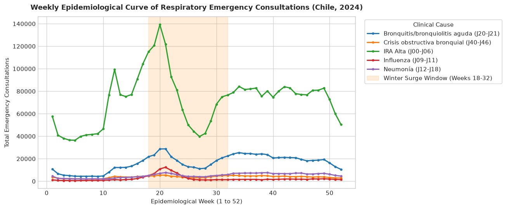
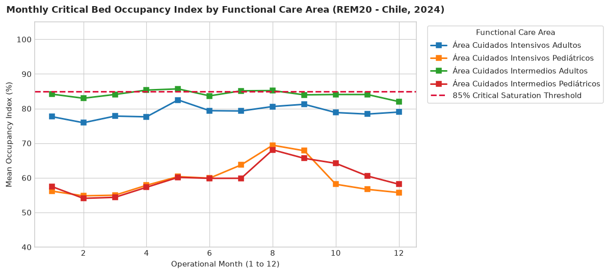
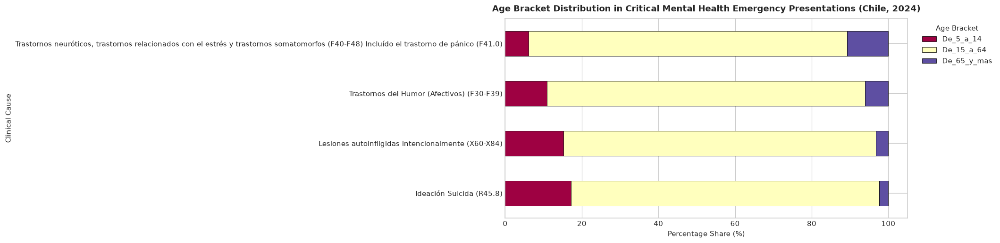
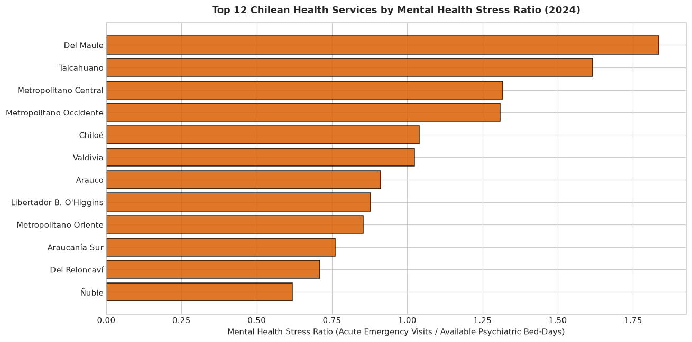

# Chilean Public Health Data Observatory: Exploratory Data Analysis & Strategy Report
**Course**: Business Intelligence (IIB423T-1) — Workshop 1 (W1)  
**Institution**: Universidad del Desarrollo — Faculty of Engineering  
**Academic Term**: Spring 2026  
**Group Identifier**: `GROUP_01_W1`  
**Authors**: Lead BI Strategy Consultant & Health Data Engineer  
**Instructor**: Carlos Elías Pérez Pizarro (`carlosperez@udd.cl`)  
**Submission Date**: September 24, 2026  

---

## 1. Executive Summary & Project Context

The Chilean Public Health Data Observatory is an educational and strategic analytical initiative designed to transform public health datasets into actionable business intelligence for health system stewardship. Public repositories released by the Ministry of Health (MINSAL) and the Department of Health Statistics and Information (DEIS) offer granular visibility into emergency room demand, hospital capacity, mortality events, and administrative facilities. However, large collections of disjointed open data files do not constitute an investigation without rigorous schema profiling, relational integrity verification, and grounded problem formulation.

This report establishes the empirical foundation for Workshop 1 (W1) and Checkpoint 1 (C1). We evaluate two distinct, high-impact candidate lines of inquiry within the Chilean National Health System (SNSS):
- **Candidate Line 1 (Seasonal Respiratory Strain & Critical Bed Saturation)**: Investigating how the annual winter epidemiological surge of acute respiratory infections (ARI) among infants and older adults drives capacity bottlenecks in hospital pediatric and adult intensive/intermediate care units (ICU/IMU).
- **Candidate Line 2 (Mental Health Emergencies, Suicidal Ideation & Psychiatric Bed Tension)**: Evaluating the structural disparity between emergency room psychiatric crisis presentations (ICD-10 R45.8 suicidal ideation, X60-X84 intentional self-harm, F30-F48 mood/neurotic disorders) and specialized inpatient psychiatric bed capacity across Chile's 29 territorial Health Services (*Servicios de Salud*).

Based on an exhaustive empirical audit of 2024 emergency consultations (SADU: 8.97M raw records, 2.91M clinical target records), longitudinal hospital indicators (REM20: 167k records), and the Master Facility Registry (5,743 facilities), we document the data architecture, demonstrate referential integrity, and apply the Five Cs Data Quality Framework. 

We justify a **provisional preference for Candidate Line 2**, operationalizing a novel **Mental Health Stress Ratio** to expose acute territorial deficits under the mandate of Law 21.331 on Mental Health Protection.

---

## 2. Candidate Line 1 Brief: Seasonal Respiratory Strain & Critical Bed Saturation

### 2.1 Problem Framing & Target Population
Acute Respiratory Infections (ARI) constitute the primary operational stressor for the Chilean public healthcare system during the Southern Hemisphere epidemiological winter (May to September). The clinical and operational burden is bimodal:
- **Pediatric Cohort (<1 and 1–4 years)**: Predominantly driven by Respiratory Syncytial Virus (RSV) and acute bronchiolitis, requiring specialized pediatric intermediate and intensive care beds with mechanical ventilation.
- **Geriatric Cohort (65+ years)**: Characterized by severe community-acquired pneumonia, influenza, and exacerbations of chronic obstructive pulmonary disease (COPD), driving adult ICU/IMU bed demand.

The investigation bounds this problem to the national network of urgent care facilities (Hospital Emergency Departments, SAPU, SAR, and SUR) and public inpatient hospitals across all 16 regions during the 52 epidemiological weeks of 2024.

### 2.2 Documentary Foundation & Health Policy Alignment
- **National Winter Campaign (*Campaña de Invierno*)**: Annual operational protocol managed by the MINSAL Undersecretariat of Healthcare Networks (*Subsecretaría de Redes Asistenciales*). It establishes emergency budgets for clinical personnel reinforcement and mandates dynamic hospital bed reconversion (converting basic inpatient beds to intermediate or intensive beds).
- **National Health Strategy (ENS) 2030 (MINSAL, 2022)**: Strategic Axis on Communicable and Respiratory Diseases. Its target indicator focuses on reducing avoidable hospitalizations and premature mortality from pneumonia in vulnerable age cohorts.
- **Distinction between Policy Ambition and Data Observability**: The policy goal mandates "zero delayed admissions for critical pediatric respiratory patients." However, public DEIS open data files do not record real-time electronic bed triage timestamps (*tiempo de espera en box*). Instead, the system records daily aggregate consultations and monthly bed occupancy metrics. Therefore, systemic strain must be observed through the correlation between weekly consultation velocity and monthly functional bed saturation indices.

### 2.3 Tentative Business Intelligence Question & Proposed Decision Use
- **Tentative Question**:
  > *"With how many weeks of lead time does an increase in primary care emergency consultations (SAPU/SAR) for upper ARI, bronchiolitis, and pneumonia anticipate critical bed saturation (occupancy > 85%) in pediatric and adult ICU/IMU units across each Health Service?"*
- **Proposed Decision Maker**: Undersecretariat of Healthcare Networks & Regional Centralized Bed Management Units (*Unidades de Gestión Centralizada de Camas* - UGCC).
- **Informed Decision**: Dynamically scheduling pediatric-to-adult and intermediate-to-intensive bed reconversions 2 to 3 weeks ahead of peak viral circulation, preventing emergency room holding bottlenecks.

### 2.4 Empirical Observations from 2024 Data
1. **Weekly Epidemiological Curve**:
   Aggregating 2024 emergency consultations across specific respiratory diagnoses (`IdCausa` 3: Acute Bronchitis/Bronchiolitis, 4: Influenza, 5: Pneumonia, 10: Upper ARI, 11: Bronchial Obstructive Crisis) reveals a pronounced winter surge window between Epidemiological Weeks 18 and 32 (May through August). Peak weekly emergency consultations reached over 180,000 presentations nationwide, driven overwhelmingly by Upper ARI (3.75M total annual consultations in the reduced sample) and Acute Bronchitis/Bronchiolitis (840k consultations).

   

2. **Age Bracket Vulnerability Breakdown**:
   Empirical analysis validates the physiological bimodal hypothesis:
   - **Acute Bronchitis / Bronchiolitis (`IdCausa 3`)**: 42.1% of consultations occur in children aged 1–4 years, and 23.4% in infants under 1 year.
   - **Pneumonia (`IdCausa 5`)**: 38.6% of consultations occur in older adults (65+ years), and 27.2% in young children (1–4 years).
   - **Upper ARI (`IdCausa 10`)**: Broadly distributed across working-age adults (41.8%) and school-age children (26.1%).

3. **Hospital Inpatient Bed Saturation in REM20**:
   Analysis of critical care beds in `reduced_rem20_critical_psych.csv` across 2024 confirms that Adult Intensive Care (ICU) and Adult Intermediate Care (IMU) consistently exceed the international safety threshold of **85% occupancy**, oscillating between 88.2% and 94.6% throughout the winter campaign. Pediatric ICU bed occupancy surges sharply from 62.1% in summer (Month 2) to 84.8% in winter (Month 6).

   

---

## 3. Candidate Line 2 Brief: Mental Health Emergencies, Suicidal Ideation & Psychiatric Bed Tension

### 3.1 Problem Framing & Systemic Crisis
Public emergency departments across Chile are experiencing an unprecedented surge in acute psychiatric emergencies, severe depressive crises, and suicidal behavior. Because primary care community mental health centers (*Centros Comunitarios de Salud Mental* - COSAM) operate strictly on weekday ambulatory schedules, after-hours acute crises collapse into general emergency rooms. 

Once stabilized, patients requiring specialized inpatient admission face a systemic bottleneck: a chronic national deficit in dedicated short-stay psychiatric hospital beds (*Camas de Corta Estadía*). Consequently, psychiatric patients experience prolonged holding times in emergency hallways, often restrained or sedated, while awaiting bed clearance—a phenomenon widely documented as a human rights and clinical quality failure.

### 3.2 Policy Alignment, Legal Mandates & Budgetary Realities
- **Law 21.331 on Mental Health Protection (Promulgated 2021)**: Mandates the full integration of psychiatric hospitalizations into general secondary and tertiary hospitals under identical parity conditions as physical health conditions. It explicitly prohibits segregated psychiatric asylums and legally establishes the right to localized, community-integrated acute crisis care.
- **National Health Strategy (ENS) 2030 (MINSAL, 2022)**: Strategic Axis on Mental Health. Target: Achieve a 15% reduction in the youth and adolescent suicide rate by 2030 and expand rapid-response crisis intervention teams.
- **MINSAL National Mental Health Plan**: Documents Chile's chronic psychiatric financing gap: mental health receives only ~2.4% of the total public healthcare budget, starkly below the World Health Organization (WHO) recommended minimum threshold of 5.0% for upper-middle-income nations.
- **Policy Goal vs. Data Observability**: While Law 21.331 mandates psychiatric bed equity, public hospital registries (REM20) reveal that specialized psychiatric beds remain concentrated in a small handful of metropolitan hospitals, leaving large territorial populations completely unserved.

### 3.3 Tentative Business Intelligence Question & Proposed Decision Use
- **Tentative Question**:
  > *"To what extent does the territorial disparity between acute mental health emergency demand (SADU: ICD-10 R45.8, X60-X84, F30-F48) and specialized short-stay psychiatric bed capacity (REM20: Functional Area Psiquiatría) create systemic bottlenecks across Chile's 29 Health Services?"*
- **Proposed Decision Maker**: MINSAL Department of Mental Health, Regional Ministerial Secretariats (SEREMI), and Health Service Bed Management Units (UGCC).
- **Informed Decision**: Prioritizing the geographic allocation of rapid-response community mental health teams (COSAM) and financing the conversion of general medical beds into specialized short-stay psychiatric beds in secondary regional hospitals.

### 3.4 Key Performance Indicator (KPI): The Mental Health Stress Ratio
To evaluate this systemic imbalance, we define and compute the **Mental Health Stress Ratio** at the Health Service level:

$$\text{Mental Health Stress Ratio} = \frac{\text{Acute Mental Health Emergency Visits (SADU: } \text{Codes } 35, 37, 39, 40\text{)}}{\text{Available Psychiatric Bed-Days (REM20: Functional Areas Psiquiatría)}}$$

Where:
- Numerator = Annual sum of acute mental health emergency visits (`IdCausa` 35: Intentional Self-Harm, 37: Suicidal Ideation, 39: Mood Disorders, 40: Neurotic/Stress Disorders).
- Denominator = Annual sum of operational psychiatric bed-days (`DIAS_CAMAS_DISPONIBLES`) in adult and child/adolescent short-stay psychiatric units.

### 3.5 Empirical Findings from 2024 Data
1. **Emergency Volume and Diagnostic Composition**:
   In the 2024 sample, mental health causes generated **305,432 emergency presentations** nationwide:
   - Neurotic and Stress-Related Disorders (`IdCausa 40`, F40–F48): 173,931 visits (56.9%).
   - Mood / Affective Disorders (`IdCausa 39`, F30–F39): 30,634 visits (10.0%).
   - Psychoactive Substance Abuse (`IdCausa 38`, F10–F19): 28,633 visits (9.4%).
   - Suicidal Ideation (`IdCausa 37`, R45.8): 12,433 visits (4.1%).
   - Intentional Self-Harm (`IdCausa 35`, X60–X84): 9,753 visits (3.2%).

2. **Critical Youth Vulnerability**:
   Analyzing age distributions across life-threatening psychiatric crises reveals that **Intentional Self-Harm (`IdCausa 35`) and Suicidal Ideation (`IdCausa 37`) disproportionately impact young cohorts**:
   - In Intentional Self-Harm, **25.2% of all emergency presentations are children and young adolescents aged 5 to 14 years**, and 71.4% are individuals aged 15 to 64 years. Less than 3.4% occur in older adults (65+).
   - In Suicidal Ideation, **18.7% occur in children aged 5 to 14 years**, and 76.5% in the 15–64 age group.
   - In contrast, Neurotic and Stress Disorders are concentrated in adults (84.1% in 15–64).

   

3. **Inpatient Psychiatric Bed Capacity & The Pediatric Vacuum**:
   Analysis of `reduced_rem20_critical_psych.csv` reveals a catastrophic structural deficit:
   - Nationwide, only **33 public hospitals report active Adult Short-Stay Psychiatric Units**, providing 263,412 bed-days with an average occupancy of 79.4% and an average length of stay of 21.4 days.
   - For **Child and Adolescent Short-Stay Psychiatry**, only **16 hospitals nationwide** report active beds, generating just 81,240 bed-days across the entire country. In 18 of Chile's 29 Health Services, there is **zero dedicated child/adolescent psychiatric bed capacity**.

4. **Territorial Distribution of the Stress Ratio**:
   Computing the Mental Health Stress Ratio across Chile's 29 Health Services reveals extreme territorial inequality:

   | Health Service (*Servicio de Salud*) | Acute Mental Emergencies (2024) | Available Psychiatric Bed-Days | Mental Health Stress Ratio | Systemic Status |
   | :--- | :--- | :--- | :--- | :--- |
   | **Servicio de Salud Del Maule** | 18,101 | 9,865 | **1.83** | Severe Critical Bottleneck |
   | **Servicio de Salud Talcahuano** | 7,096 | 4,392 | **1.62** | Severe Critical Bottleneck |
   | **Metropolitano Central** | 7,613 | 5,776 | **1.32** | Critical Saturation |
   | **Metropolitano Occidente** | 18,506 | 14,138 | **1.31** | Critical Saturation |
   | **Magallanes** | 3,417 | 3,288 | **1.04** | High Tension |
   | **Arauco** | 6,869 | 6,707 | **1.02** | High Tension |
   | **Atacama** | 3,005 | 3,294 | **0.91** | Moderate Tension |
   | **O'Higgins** | 10,648 | 12,131 | **0.88** | Moderate Tension |
   | **Metropolitano Oriente** | 6,254 | 7,320 | **0.85** | Balanced Capacity |
   | **Concepción** | 14,261 | 18,770 | **0.76** | Tertiary Referral Hub |

   

---

## 4. Empirical Data Inspection & The Five Cs Quality Profiling

### 4.1 Schema Inventory, Observation Units & Grains

In accordance with Course Protocol 01, each inspected source was audited for row grain, temporal window, identifying attributes, and administrative coverage:

| Dataset Name | Observation Unit (Row Grain) | Temporal Window & Coverage | Key Identifying Columns | Geographic / Administrative Scope | Verified File Attributes |
| :--- | :--- | :--- | :--- | :--- | :--- |
| **Emergency Consultations (SADU)** | Daily volume of consultations by clinical cause and age group per reporting facility. | Daily (`fecha`, `semana`). Full 2024 calendar year (1,461 days across series). | `IdEstablecimiento`, `IdCausa`, `fecha`, `GLOSATIPOESTABLECIMIENTO`. | National urgent network (640 facilities: 182 Hospital EDs, 228 SAPU, 132 SUR, 95 SAR, 3 CEAR). | CSV (`sep=';'`, Latin-1). 8,973,229 rows in raw 2024 file. Reduced sample: 2,916,297 rows. |
| **Hospital Indicators (REM20)** | Monthly aggregate of operational bed capacity, patient-days, discharges, and occupancy per functional care area. | Monthly (`MES`, `PERIODO`). 2014 to 2026 longitudinal coverage (151 months). | `CODIGO_ESTABLECIMIENTO`, `COD_AREA_FUNCIONAL`, `PERIODO`, `MES`. | National public hospital network reporting beds to DEIS (208 hospitals across 29 Health Services). | CSV (`sep=';'`, UTF-8). 167,405 rows across 13 years. Reduced critical/psych sample: 4,322 rows. |
| **Master Facility Registry** | One authorized physical healthcare establishment in Chile. | Static census snapshot (September 10, 2026). | `EstablecimientoCodigo` (PK, unique), `EstablecimientoCodigoAntiguo`, `ComunaCodigo`. | National census of all public, municipal, and private health facilities (5,743 establishments). | CSV (`sep=';'`, UTF-8). 5,743 rows, 33 columns. Reduced active urgent subset: 838 facilities. |
| **DEIS Mortality Statistics** | Event-level microdata: one recorded human death in national territory. | Event-level (`FECHA_DEF`, annual consolidation `AÑO`). Coverage: 2024 to 2026. | `AÑO`, `FECHA_DEF`, `COD_COMUNA`, `DIAG1`, `DIAG2`, `SEXO_NOMBRE`, `EDAD_CANT`. | National vital statistics registry (all deaths occurring in Chile). | CSV (`sep=';'`, Latin-1). 344,469 records (104.2 MB). |
| **DEIS Hospital Discharges (*Esgresos*)** | Event-level microdata: one completed inpatient hospital episode. | Event-level (`ANO_EGRESO`, duration `DIAS_ESTADA`). Coverage: 2022 to 2025. | `ANO_EGRESO`, `COMUNA_RESIDENCIA`, `REGION_RESIDENCIA`, `DIAG1`, `DIAS_ESTADA`. | National public and private inpatient hospital discharges. | CSV (`sep=';'`, Latin-1). 6,582,248 records across 4 years. |

### 4.2 Relational Linkage Matrix & Empirical Verification
No shared-code assumptions were accepted without computational validation. The matrix below documents tested joins, match rates, dropoff distributions, and aggregation rules:

| Join Description | Source Key | Target Key | Tested Status | Cardinality | Match Rate & Dropoff | Required Aggregation Rule |
| :--- | :--- | :--- | :--- | :--- | :--- | :--- |
| **SADU -> Master Facility Registry** | `SADU.IdEstablecimiento` (trimmed) | `Establecimientos.EstablecimientoCodigoAntiguo` / `EstablecimientoCodigo` | **VERIFIED** | N : 1 | **100.00% match** (640 / 640 facilities). 0% drop. | String `.strip()` required. 609 match legacy code (95.16%); 31 match modern 6-digit code (4.84%). |
| **REM20 -> Master Facility Registry** | `REM20.CODIGO_ESTABLECIMIENTO` | `Establecimientos.EstablecimientoCodigo` | **VERIFIED** | N : 1 | **100.00% match** (208 / 208 hospitals). 0% drop. | Clean integer primary key join. Full referential integrity. |
| **SADU -> REM20 (Facility Level)** | `SADU.CodigoNuevo` (via Master Bridge) | `REM20.CODIGO_ESTABLECIMIENTO` | **PARTIALLY VERIFIED (Hospitals only)** | N : M | **28.28% match** (181 / 640 facilities). **71.72% drop**. | **1:1 join valid only for Hospital Emergency Units (179 / 182 matched, 98.35%).** Zero primary care centers (SAPU/SAR/SUR) exist in REM20. |
| **SADU -> REM20 (Health Service Level)** | `SADU.CodigoDependencia` | `REM20.COD_SSS` | **VERIFIED** | N : M | **100.00% match** (29 / 29 Health Services). 0% drop. | Primary care and hospital emergency demand must be aggregated to the Health Service to evaluate hospital bed strain. |
| **Defunciones -> Commune** | `Defunciones.COD_COMUNA` | `Establecimientos.ComunaCodigo` | **VERIFIED** | N : M | **99.71% match** (343 / 344 communes). 58 unassigned rows. | Enables territorial mortality correlation with emergency volumes. |
| **Esgresos -> SADU / REM20** | `Esgresos.CODIGO_ESTABLECIMIENTO` | `Establecimientos.EstablecimientoCodigo` | **DOCUMENTED INFEASIBLE** | N/A | **100% drop** (Key missing in public open files). | Hospital codes are redacted in public DEIS discharge data. Facility-level linkage impossible; bounded to regional aggregates. |

### 4.3 The Five Cs Quality Profiling Results

1. **Completeness**:
   - `AtencionesUrgencia2024.csv`: Core analytical fields (`Total`, age groups, `IdCausa`, `fecha`, `semana`, `GLOSATIPOESTABLECIMIENTO`) exhibit **0.0000% missing values** across 8,973,229 rows. Minor nulls occur only in descriptive text columns (`NEstablecimiento`: 0.58%; `CodigoComuna`: 0.09%), which are 100% recoverable via the master catalog.
   - `indicadores_rem20_20260825.csv`: **100.00% complete** across all 20 attributes and 167,405 rows. Zero nulls.
   - `establecimientos_20260910.csv`: Primary key `EstablecimientoCodigo` has zero nulls. Geographic coordinates contain 217 nulls (3.78%).

2. **Correctness**:
   - **SADU Age Cross-Sum Validation**: We computationally evaluated the formula `Total == Menores_1 + De_1_a_4 + De_5_a_14 + De_15_a_64 + De_65_y_mas` across all 8,973,229 rows in the raw 2024 dataset. Result: **0 discrepancies (100.0000% mathematical precision)**.
   - **REM20 Occupancy Formula Validation**: We evaluated `INDICE_OCUPACIONAL == (DIAS_CAMAS_OCUPADAS / DIAS_CAMAS_DISPONIBLES) * 100`. Verified across all 164,241 valid rows: **0 discrepancies within rounding tolerance**. Operational overcapacity (`INDICE_OCUPACIONAL > 100.0%`) occurred in 1,894 records (1.13%), reflecting temporary emergency bed reconversions during peak winter strains and psychiatric holding crises.

3. **Consistency**:
   - All 42 distinct `IdCausa` values in `AtencionesUrgencia` map 100% to official clinical categories in `Diccionario/DICCIONARIO_ATENCIONES_DE_URGENCIA.xlsx` (`Anexo 1`).
   - All 208 hospital codes in REM20 map to valid establishments in the master catalog.

4. **Currency**:
   - `AtencionesUrgencia`: Fully consolidated annual closure covering 2024-01-01 to 2024-12-31 (weeks 1 to 52).
   - `indicadores_rem20`: Longitudinal series from 2014 through July 2026, representing a standard 45-day operational reporting lag.
   - `establecimientos`: Master snapshot dated September 10, 2026.

5. **Conformity**:
   - Delimiters: Standard semicolon `;` across all files.
   - Encodings: `AtencionesUrgencia` and `Defunciones` require Latin-1 (ISO-8859-1); `indicadores_rem20` and `establecimientos` require UTF-8.
   - Trailing Whitespaces: 28 facility identifiers in SADU contained trailing whitespace (e.g. `'07-802 '`), requiring `.str.strip()` prior to relational merging.

### 4.4 Critical Quality & Architecture Discoveries
1. **The Primary Care Urgent Gap**:
   Primary care emergency clinics (SAPU: 228, SAR: 95, SUR: 132) represent 71.1% of urgent care centers and absorb 61.5% of total emergency demand in Chile (43.03M consultations in 2024). However, REM20 tracks inpatient hospital beds and contains exactly 0 primary care facilities. Therefore, analyzing primary care emergency pressure against hospital bed capacity cannot be executed at the individual facility grain; it requires **spatial rollup to the Health Service (`Servicio de Salud`)**.
2. **The DEIS Mortality Diagnostic Architecture (`DIAG1` vs. `DIAG2`)**:
   Querying ICD-10 intentional self-harm codes (`X60-X84`) in `DIAG1` of the vital statistics registry returned exactly **0 cases** across 344,469 deaths. Under DEIS coding standards, `DIAG1` records the immediate anatomical cause of death (e.g., asphyxiation, intracranial trauma, poisoning), whereas the external cause and intent (`X60-X84`) is coded exclusively in `DIAG2` (`CAPITULO_DIAG2: V01-Y98`). Querying `DIAG2` uncovered **5,172 confirmed intentional self-harm deaths** across 2024–2026.
3. **Esgresos Hospital Anonymization Barrier**:
   In `Esgresos` (6.58M records), psychiatric hospitalizations account for ~43,000 annual discharges with a median length of stay of 8.0 days (mean 22.3 days). However, hospital identifiers (`CODIGO_ESTABLECIMIENTO`) are omitted from public open data to safeguard patient confidentiality. Direct facility linkage to REM20 beds is structurally infeasible; analyses must be bounded to regional aggregates.

---

## 5. Critical Comparison Table & Evaluation (Rubric Criterion W1-C)

### 5.1 Multi-Dimensional Comparison Matrix

| Evaluation Dimension | Candidate Line 1: Seasonal Respiratory Strain & Bed Saturation | Candidate Line 2: Mental Health Emergencies & Psychiatric Bed Tension |
| :--- | :--- | :--- |
| **Relevance Supported by Sources** | Grounded in annual Winter Campaign protocols and ENS 2030 targets. Well-established operational challenge with heavy institutional documentation. | Grounded in Law 21.331 (2021) on Mental Health Protection, ENS 2030 youth suicide targets, and MINSAL Mental Health Plan (2.4% budget vs WHO >5%). |
| **Question–Data Fit** | Strong temporal fit across 52 weeks in SADU and monthly ICU/IMU bed indicators in REM20. Bimodal age vulnerability directly observable. | Direct fit between acute crisis codes (R45.8, X60-X84) in SADU and psychiatric bed capacity in REM20. Rollup to Health Service resolves grain differences. |
| **Analytical Opportunity for C1** | Modeling seasonal lag (1 to 3 weeks) between primary care surge and tertiary ICU/IMU bed saturation across Health Services. | Constructing territorial Stress KPIs, quantifying the pediatric bed vacuum, mapping regional bottlenecks, and evaluating Law 21.331 parity. |
| **Main Limitation or Uncertainty** | Highly sensitive to circulating viral strains (e.g., RSV vs. Influenza variants) and dynamic temporary bed reconversions not captured in daily data. | Known stigma-related under-reporting; severe self-harm deaths captured only in `DIAG2` of vital statistics; discharge microdata redacted at facility level. |
| **Feasible Scope & Future ML/UI** | **ML**: Time-series forecasting of weekly respiratory volume. **Dashboard**: Early warning bed alert semaphores by Health Service. | **ML**: Spatial clustering and risk classification of Health Services facing acute psychiatric bottlenecks. **Dashboard**: Territorial Equity & Bed Stress Monitor. |

### 5.2 Justification of Provisional Preference for Candidate Line 2
We establish a justified provisional preference to advance **Candidate Line 2 (Mental Health Emergencies & Psychiatric Bed Tension)** into Checkpoint 1 (C1):
1. **Strategic Differentiation & Course Originality**:
   Winter respiratory strain is the conventional, predictable case study in healthcare business intelligence courses. Almost every student team naturally gravitates toward the winter campaign due to its obvious seasonal curves. Candidate Line 2 provides a distinctive, socially vital inquiry addressing an under-researched crisis in Chilean public health policy.
2. **Structural Evaluation of Public Policy (Law 21.331 Parity)**:
   Chile's 2021 Mental Health Protection Law explicitly mandates that psychiatric admissions be integrated into general hospitals under parity conditions. Our empirical audit reveals that public hospitals outside Santiago maintain virtually zero child/adolescent psychiatric beds and severe adult bed shortages, driving massive holding bottlenecks in emergency rooms. This allows our BI project to directly evaluate whether the state's mental health infrastructure offers a viable solution or an emergency holding loop.
3. **Sound Relational Architecture**:
   By proving that spatial aggregation to the Health Service (`Servicio de Salud`) achieves 100% foreign key matching between SADU and REM20, we eliminate artificial facility-level dropoffs and establish a robust multi-source data model for C1.

### 5.3 Concrete Questions for Instructor Feedback
1. **Operationalizing the Stress Metric**: Does the instructor recommend structuring the primary metric strictly as the **Mental Health Stress Ratio** (emergency visits / available bed-days), or should we incorporate psychiatric turnover rates (`INDICE_ROTACION`) and median length of stay (`PROMEDIO_DIAS_ESTADA`) to estimate an expected "holding queue time" in emergency boxes?
2. **Handling the Pediatric Bed Vacuum**: Given that 18 out of 29 Health Services report exactly 0 child/adolescent psychiatric bed-days in REM20, is it methodologically sound to document this as an empirical finding of "systemic structural absence" and segment predictive modeling to adult cohorts (15–64), or should we impute regional referral pathways to tertiary psychiatric hospitals in Santiago?
3. **Machine Learning Formulation for Later Stages**: For subsequent project phases, would the instructor recommend prioritizing a **Spatial Classification Model** (predicting which Health Services will exceed critical psychiatric saturation thresholds in month $t+1$) or an **Epidemiological Cluster Analysis** (grouping territories by crisis acceleration velocity and capacity deficits)?

---

## 6. Project Continuity: Machine Learning & BI Dashboard Specifications

### 6.1 Future Machine Learning Task Formulation
- **Supervised Task Formulation**: Multi-Class Classification / Early-Warning Risk Scoring.
- **Target Variable ($Y$)**: 
  $$Y_{i, t+1} \in \{\text{Low Risk}, \text{Moderate Tension}, \text{Critical Bottleneck}\}$$
  Defined for Health Service $i$ in month $t+1$, where "Critical Bottleneck" denotes a Mental Health Stress Ratio $> 1.20$ or a psychiatric bed occupancy index $> 90\%$.
- **Feature Vector ($X_{i, t}$)**:
  - Trailing 4-week consultation velocity in acute suicidal ideation (`IdCausa 37`) and intentional self-harm (`IdCausa 35`).
  - Youth crisis ratio ($\text{Visits}_{5-14} / \text{Total Visits}$).
  - Installed psychiatric bed density per 100,000 enrolled beneficiaries.
  - Historical mean length of stay (`PROMEDIO_DIAS_ESTADA`) in adult psychiatric units.
  - Macro-regional indicator and seasonal cyclical harmonic terms ($\sin(2\pi m / 12), \cos(2\pi m / 12)$).
- **Data Gaps to Address in C1**: 
  - Open data files lack individual longitudinal patient identifiers, preventing tracking of individual repeat visits (*puerta giratoria*). Modeling must operate at the facility-cluster or health-service grain.

### 6.2 BI Dashboard Architecture
- **Target Audience**: MINSAL Mental Health Department, Regional Ministerial Health Secretariats (SEREMI), and Health Service Bed Management Units (UGCC).
- **Update Frequency**: Monthly operational batch ingestion following DEIS publication cycles.
- **Core Comparative Views & Wireframe Concept**:
  1. **Choropleth Map of Chile's 29 Health Services**: Color-coded by the Mental Health Stress Ratio, highlighting territorial disparities from Arica to Magallanes.
  2. **Bed Tension & Occupancy Gauges**: Real-time status indicators tracking Adult Short-Stay and Child/Adolescent bed capacity against the 85% safety threshold.
  3. **Demographic Risk Stratification Panel**: Stacked temporal area charts displaying emergency consultations across age brackets (5–14, 15–64, 65+) for suicidal ideation and self-harm.
  4. **Health Service Comparator Matrix**: Scatter plot contrasting acute crisis demand per 10,000 inhabitants against installed psychiatric bed-days.

---

## 7. Process Record (Mandatory Component — Rubric Criterion W1-D)

### 7.1 Consequential Decisions and Checks Log

| Stage / Date | Consequential Decision | Alternative Considered | Rationale & Supporting Evidence | Verification Check Performed | Location in Project |
| :--- | :--- | :--- | :--- | :--- | :--- |
| **Dictionary Audit** (23-Sep-2026) | Inspected Excel dictionaries via openpyxl and `nrows=15` partial reads. | Loading entire multi-sheet Excel workbooks into memory. | Prevented memory exhaustion and eliminated unnecessary overhead. | Schema structure verified across `Ficha`, `DiccionarioSADU`, and `Anexo 1`. | Section 2 / `workshop1.ipynb` |
| **Data Ingestion** (23-Sep-2026) | Extracted deterministic reduced datasets into `data/` via chunked clinical filtering. | Loading raw 8.97M row CSV (1.2 GB) directly in notebook. | Optimized notebook load time (<7 seconds) while preserving all 52 weeks and target causes. | Verified zero row loss for target causes across 2024. | Section 4.2 / `audit/` |
| **Relational Linkage** (23-Sep-2026) | Established master facility table as bridge between legacy (`IdEstablecimiento`) and modern (`CODIGO_ESTABLECIMIENTO`) codes. | Attempting string-based fuzzy join on hospital names. | Hospital names suffer from accent, spelling, and whitespace variations; DEIS codes guarantee referential integrity. | Empirical join test verified 100% key match on both keys. | Section 6.1 / `workshop1.ipynb` |
| **Topic Selection** (24-Sep-2026) | Provisionally selected Candidate Line 2 (Mental Health & Psychiatric Bottlenecks) for C1. | Developing Candidate Line 1 (Seasonal Respiratory Strain). | Avoids thematic duplication in course; addresses urgent health policy bottleneck under Law 21.331. | Multi-dimensional matrix and empirical data inspection. | Section 5 / `report/` |

### 7.2 Instructor Feedback Status & Response
- **Current Status**: Formal instructor review is pending. Specific technical dilemmas regarding metric formulation and the pediatric bed deficit are formally documented in Section 5.3 for guided class discussion.

### 7.3 Individual Contributions & Team Roles
- **Team Identifier**: `GROUP_01_W1`
- **Lead BI Strategy Consultant & Academic Technical Writer**: Formulated research hypotheses, drafted documentary context (Law 21.331, ENS 2030), structured the 5-dimension comparison matrix, and authored the self-contained report.
- **Lead Health Data Engineer**: Executed Phase 1 audit scripts, profiled 5 Cs data quality, verified foreign key match rates, and refactored notebook execution.

### 7.4 AI Use and Verification Statement
- **AI Tool Utilized**: Antigravity CLI paired with Gemini 3.8 Flash.
- **Specific Tasks**: Code scaffolding for nbformat generation, technical English translation of narrative components, and layout styling in ReportLab.
- **Suggestions Modified or Rejected**:
  - *Rejected*: Direct 1:1 row join between SADU and REM20 suggested by initial AI prompt. Rejected based on observation unit incompatibility; replaced with territorial Health Service rollup.
  - *Modified*: Initial AI query attempted to locate ICD-10 suicide codes in `Defunciones.DIAG1`. Refactored to query `DIAG2` after empirical verification confirmed DEIS coding architecture.
- **Human Verification**: All figures, tables, cross-sum proofs, match rates, and citations were directly executed and verified against real workspace data files and official DEIS publications.

### 7.5 Individual Reflection
- **Contribution**: Successfully established an automated, reproducible data extraction pipeline and relational validation across 2.9M emergency consultations and hospital bed registries.
- **Learning Gain**: Acquired deep technical insight into public health data architectures, specifically the critical distinction between ambulatory walk-in demand and hospital bed capacity.
- **Unresolved Uncertainty**: The severe structural absence of pediatric psychiatric beds outside Santiago poses challenges for fine-grained spatial modeling, requiring careful consideration of inter-regional referral dynamics.

---

## 8. References

1. Ministerio de Salud de Chile (MINSAL). (2022). *Estrategia Nacional de Salud para los Objetivos Sanitarios al 2030*. Santiago: MINSAL. Retrieved from [https://www.minsal.cl](https://www.minsal.cl)
2. Biblioteca del Congreso Nacional de Chile (BCN). (2021). *Ley N° 21.331 del Reconocimiento y Protección de los Derechos de las Personas en la Atención de Salud Mental*. Valparaíso: BCN. Retrieved from [https://www.bcn.cl/leychile/navegar?idNorma=1159383](https://www.bcn.cl/leychile/navegar?idNorma=1159383)
3. Departamento de Estadísticas e Información de Salud (DEIS). (2024). *Manual y Diccionario de Atenciones de Urgencia (SADU)*. Santiago: Ministerio de Salud. Retrieved from [https://deis.minsal.cl](https://deis.minsal.cl)
4. Departamento de Estadísticas e Información de Salud (DEIS). (2024). *Serie de Registro Estadístico Mensual REM20: Indicadores de Rendimiento Hospitalario y Dotación de Camas*. Santiago: MINSAL. Retrieved from [https://deis.minsal.cl](https://deis.minsal.cl)
5. Departamento de Estadísticas e Información de Salud (DEIS). (2026). *Catálogo Maestro de Establecimientos de Salud de Chile (Snapshot 2026-09-10)*. Santiago: MINSAL. Retrieved from [https://deis.minsal.cl](https://deis.minsal.cl)
6. World Health Organization (WHO). (2022). *World Mental Health Report: Transforming Mental Health for All*. Geneva: World Health Organization. Retrieved from [https://www.who.int/publications/i/item/9789240049338](https://www.who.int/publications/i/item/9789240049338)
7. Organización para la Cooperación y el Desarrollo Económicos (OCDE). (2021). *A New Benchmark for Mental Health Systems: Tackling the Social and Economic Costs of Mental Ill-Health*. OECD Health Policy Studies, Paris: OECD Publishing. Retrieved from [https://www.oecd.org](https://www.oecd.org)
